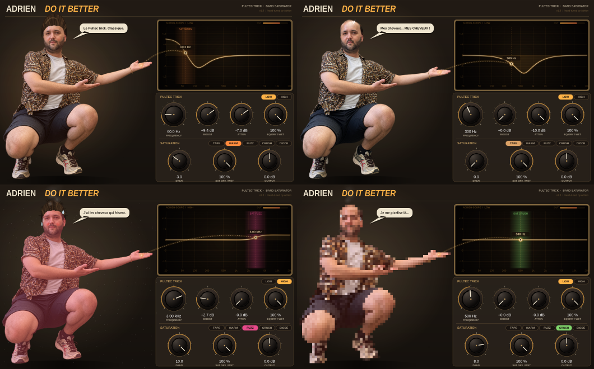

# ADRIEN DO IT BETTER — v1.0



**Télécharger le VST3 :** onglet *Releases* (ou *Actions* → dernier build → artefact `ADRIEN_DO_IT_BETTER_VST3_macOS`). Après téléchargement, si macOS bloque le plugin :
`xattr -dr com.apple.quarantine ~/Library/Audio/Plug-Ins/VST3/"ADRIEN DO IT BETTER.vst3"`

Un plugin VST3 pour macOS qui fait le Pultec trick et sature une bande de fréquences, avec Adrien qui te montre ce qui se passe.

## Compiler et installer (macOS)

1. Installe les outils Apple si ce n'est pas déjà fait : `xcode-select --install`
2. Installe CMake : `brew install cmake`
3. Dans le Terminal, depuis ce dossier :
   ```
   chmod +x build_mac.sh
   ./build_mac.sh
   ```
   JUCE 8.0.4 est téléchargé automatiquement au premier build (compte quelques minutes).
   Le binaire est universel (Apple Silicon + Intel), pour macOS 11 et plus.
4. Le plugin est copié dans `~/Library/Audio/Plug-Ins/VST3/ADRIEN DO IT BETTER.vst3`. Il te suffit de relancer le DAW.

Si tu veux aussi un AU (pour Logic) : `cmake -S . -B build -DADRIEN_PLUGIN_FORMATS="VST3;AU"` puis `cmake --build build --config Release`.

## Les réglages

| Section | Réglage | Ce que ça fait |
|---|---|---|
| PULTEC TRICK | FREQUENCY | 20 Hz – 16 kHz. Tu peux aussi glisser sur l'écran ou utiliser la molette. Double-clic = 60 Hz. |
| | BOOST (0–10) | Shelf jusqu'à +13,5 dB |
| | ATTEN (0–10) | Cloche jusqu'à −10 dB, réglée sur la même fréquence et décalée d'une octave. Avec BOOST, ça donne la bosse et le creux du Pultec trick. |
| | LOW / HIGH | LOW : boost dans le grave, creux au-dessus. HIGH : le même principe inversé, pour l'air. |
| | EQ DRY / WET | Mélange entre le signal non égalisé et le signal égalisé |
| SATURATION | TAPE / WARM / FUZZ / CRUSH / DIODE | Type de saturation |
| | DRIVE (0–10) | Jusqu'à +30 dB dans la bande. À 0, le signal n'est pas touché. |
| | SAT DRY / WET | Mélange de la bande saturée |
| | OUTPUT | ±18 dB |

La saturation ne touche qu'une bande d'environ 1,7 octave autour de FREQUENCY. Le reste du spectre passe sans être saturé. Elle tourne en suréchantillonnage ×4 pour éviter l'aliasing, ce qui ajoute 4 échantillons de latence (déclarés à l'hôte).

## Adrien

- **Boost** : il sourit, rougit un peu, et une banane lui pousse sur la tête.
- **Atten** : il fait la moue, perd ses cheveux, et son crâne se met à briller.
- **Frequency** : son bras suit le repère sur l'écran, et un faisceau part de sa main.
- **Drive** : il chauffe, transpire, puis fume et tremble. Chaque type a en plus son effet :
  - TAPE : sépia et pleurage
  - WARM : halo orange
  - FUZZ : cheveux qui frisent et grain
  - CRUSH : Adrien pixelisé
  - DIODE : arcs électriques
- **Audio** : il pulse avec le niveau de sortie, et la bulle commente ce que tu fais.

## Structure

- `Source/Dsp.h` : biquads, SVF, saturations, réponse de l'EQ
- `Source/PluginProcessor.*` : paramètres et traitement audio
- `Source/PluginEditor.*` : interface, potards et bulle
- `Source/AdrienView.*` : toutes les animations d'Adrien
- `Source/EqScreen.*` : l'écran de courbe interactif
- `Assets/` : calques d'Adrien (corps, bras, version chauve)
